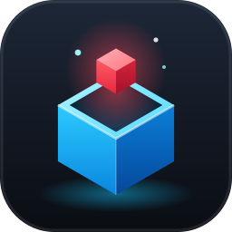
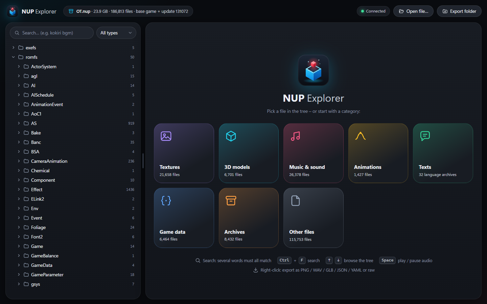
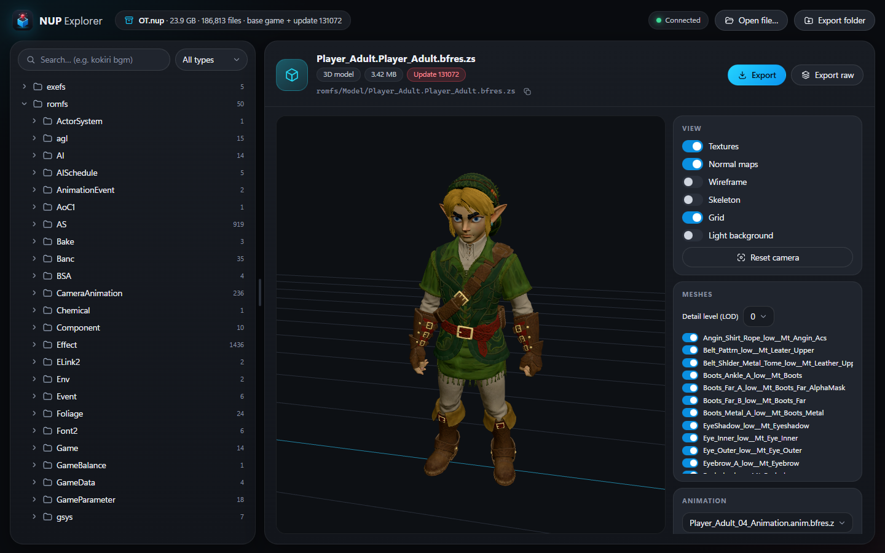
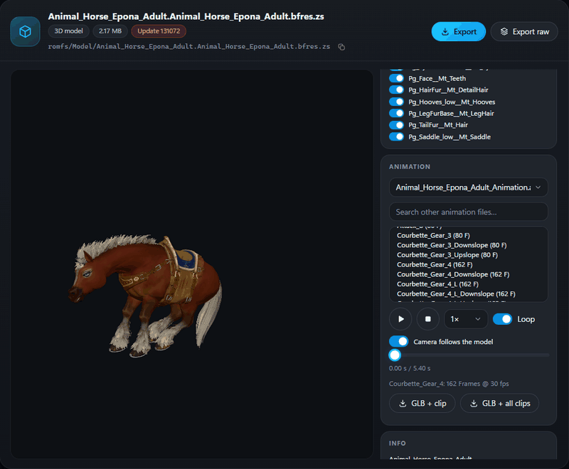

<p align="center"></p>

<h1 align="center">NUP Explorer</h1>

<p align="center">
Browse, preview and extract the assets of <b>NUP</b> game containers (Nintendo Switch 2 titles, base game + update in one file):
textures, music and voice, 3D models with skeletal animations, texts and game data.
</p>



## Features

- **File tree** of the whole container – base game and update merged (the update wins), lazily loaded and
  virtualized (folders with 20,000+ entries stay smooth), search (all words must match) and type filter.
  SARC/pack archives expand like folders.
- **Textures** (BNTX with the Switch 2 block-linear swizzle): BC1–BC7, BC6H, ASTC 4×4 … 12×12, R8G8, R16,
  R16G16, R11G11B10F, RGBA16F. Zoom/pan, single channels, mip levels, array layers and cube faces.
- **Audio** (BWAV): DSP-ADPCM and Opus, waveform, seeking, loop points from the file, up to 6 channels
  (the preview is mixed down to stereo, the export keeps all channels).
- **3D models** (BFRES v10): meshes and LOD levels, textures and normal maps, skeleton, **skeletal
  animations** including mesh visibility tracks, and the game's **compressed meshlet geometry** used by most
  map parts. Material colours are approximated from the shader parameters (gems, glass, liquids, hair, eyes);
  emission maps make lights and glowing parts glow. Animation files are matched to their models by name
  (including shared character animations for costume models); files with only material animations are marked.
- **Texts** (MSBT) as a table with a second language side by side, download as JSON/CSV.
- **Game data** (BYML/GYML) as YAML with search, download as YAML/JSON.
- **Export** – single files, folders or archives:
  *converted* (textures → PNG, audio → WAV, models → GLB with textures, texts → JSON, data → YAML,
  archives → folders) or *raw* (just unpacked). Folders are exported in parallel; models can be exported
  as GLB together with one or all animations (opens in Blender).
- Runs completely **locally**: a small server bound to `127.0.0.1` with a random access token, shown in its
  own app window (Microsoft Edge in app mode). Nothing is uploaded anywhere.

## Screenshots

**3D models** – textures and normal maps, detail levels (LOD), mesh list with visibility toggles, skeleton,
export as GLB:



**Skeletal animations** – matching animation files are suggested for every model; clips play with timeline,
speed and loop while the camera follows the model, and model + animations can be exported together as GLB:



## Download

Windows: download `NupExplorer.exe` from the [latest release](../../releases/latest) – no installation and no
Python needed. Microsoft Edge (preinstalled on Windows 10/11) is used for the window.

Start it, pick your `.nup` file, done. The last file is remembered. Closing the window ends the program after
a few seconds (unless an export is still running).

## Usage

| What | How |
|---|---|
| View a file | click it in the tree (arrow keys work too) |
| Search | search box at the top left; several words = all must match; type filter next to it |
| Jump from a search result to its folder | right-click → *Show in tree* |
| Open an archive | expand it like a folder |
| Export | right-click a file, folder or archive – or use the buttons in the viewer header |
| Change the export folder | button at the top right |
| Play / pause audio | <kbd>Space</kbd> |
| Animations | choose a 3D model → pick an animation file (suggestions are shown) → click a clip |

Command line:

```
NupExplorer.exe [file.nup] [--browser app|default|none] [--port N] [--keep-running]
```

- `--browser default` opens the UI in your default browser, `none` opens nothing (the URL is printed/logged).
- `--keep-running` keeps the server alive when the window is closed.

Settings are stored in `%APPDATA%\NupExplorer\settings.json`; the file index cache, the browser profile of the
app window and the log (`log.txt`, EXE only) live in `%LOCALAPPDATA%\NupExplorer\`.

## Run from source

Requires Python 3.14 (Windows; tested with 3.14.0).

```
pip install -r requirements.txt
python app.py [path\to\file.nup]
```

or simply `start.bat`.

### Build the EXE

```
pip install pyinstaller
build_exe.bat
```

The result is `dist\NupExplorer.exe` (single file, no console window).

### Tests

They need a NUP file – pass it as argument or set `NUP_FILE`:

```
python tests\smoke.py path\to\file.nup        # random samples of every file type + regressions
python tests\model_qa.py path\to\file.nup     # quality check of all 3D models (missing textures, materials, geometry)
python tests\curve_check.py path\to\file.nup  # animation curve decoder acceptance test
```

## Format notes

Everything below was reverse engineered from the data; details are in the module docstrings.

- **NUP container** (`nupx/container.py`): header `NUP\x01`, TOC with sections (base game, update),
  directory and file tables, string pool, SHA-256 per file. Files are stored unencrypted; newer NUP files
  store some files as a single zstd frame (file record: compression 1, stored size, original size).
- **Zstd**: dictionary chosen by the ID in the frame header (1 `zs`, 2 `bkprb`, 3 `bcett.byml`, 4 `pack`,
  taken from `romfs/Pack/ZsDic.pack.zs`).
- **BNTX** (`nupx/textures.py`): platform block `Ounc`; Switch 2 GOB bit order `x0..x3, y0, y1, x4, y2, x5`.
- **BWAV** (`nupx/audio.py`): DSP-ADPCM, or Nintendo Opus packets re-muxed into Ogg.
- **BFRES v10.2 / v10.4** (`nupx/bfres.py`, `nupx/anim.py`): skeletal animation curves are cubic Hermite curves
  with (value, slope) per key, quantized (8/16-bit keys after a slope header; v10.4 also sets flag 0x0800) or
  float; 8/16-bit frame numbers are multiplied by the curve's frame scale when flag 0x0400 is set; quaternion
  curves (flag 0x80) use slerp; Euler rotations compose as R = Rz·Ry·Rx and the rotation type is chosen
  **per bone** (flag 0x00100000).
- **Texts**: one SARC per language (`romfs/Mals/<Lang>.Product.<ver>.sarc.zs`) or one folder per language
  (`romfs/Mals/<Lang>/*.msarc`); the language compare looks up the same MSBT in the other language.
- **Materials**: render-info and shader-parameter names are only stored as 64-bit hashes. Identified by
  comparing all materials: render info `c449e543484e03dc` = "shadow only", `9637173a98b4d882` = blend mode,
  colour parameters `ad91cd2b…`, `d8c1e846…`, `6e1f54c6…` carry the surface colour of untextured materials.
- **Compressed meshlet geometry** (`nupx/clusters.py`): shapes with flag 0x10 and an empty FVTX store their
  geometry as meshlets (≤ 64 vertices / 124 triangles) for up to 16 LOD levels. Each meshlet record
  (32 bytes + 8 per UV set or colour) holds origin and extent (3 × 21 bit on a 0.5 mm grid), triangle and
  vertex count, data offset, bits per vertex and UV offsets; the vertex data is an LSB-first bit stream
  (position, octahedral normal, tangent, UV sets as `(offset + value) · 2^(exponent − 16)`, colours), followed
  by the triangle indices.

## Limitations

- Materials are approximated with a base colour and a normal map. Effects that only exist in the game's
  shaders (e.g. the dark look of shadow characters, terrain blending) are not reproduced.
- A few materials reference textures that do not exist in the game files; they show a shader colour or grey.
  Untextured materials whose colour parameters are not known yet are shown grey as well.
- Material animations (texture scrolling, colour changes) are recognised but not played.
- Terrain (`TerrainArc`), effects and physics data are only available as hex view / raw export.

## Legal

NUP Explorer is an independent, fan-made tool. It is **not affiliated with, endorsed or sponsored by
Nintendo**. The repository and the release contain **no game data, keys or copyrighted assets**, and the tool
does not decrypt or circumvent any protection – it only reads unencrypted NUP files you provide.
Use it only with files you are legally allowed to use. Extracted assets remain the property of their
respective owners; do not redistribute them. The screenshots show game assets for illustration only – all
rights to them belong to their owners. All trademarks belong to their respective owners.

## License

[MIT](LICENSE). Third-party components and their licenses are listed in [THIRD_PARTY_NOTICES.md](THIRD_PARTY_NOTICES.md).
